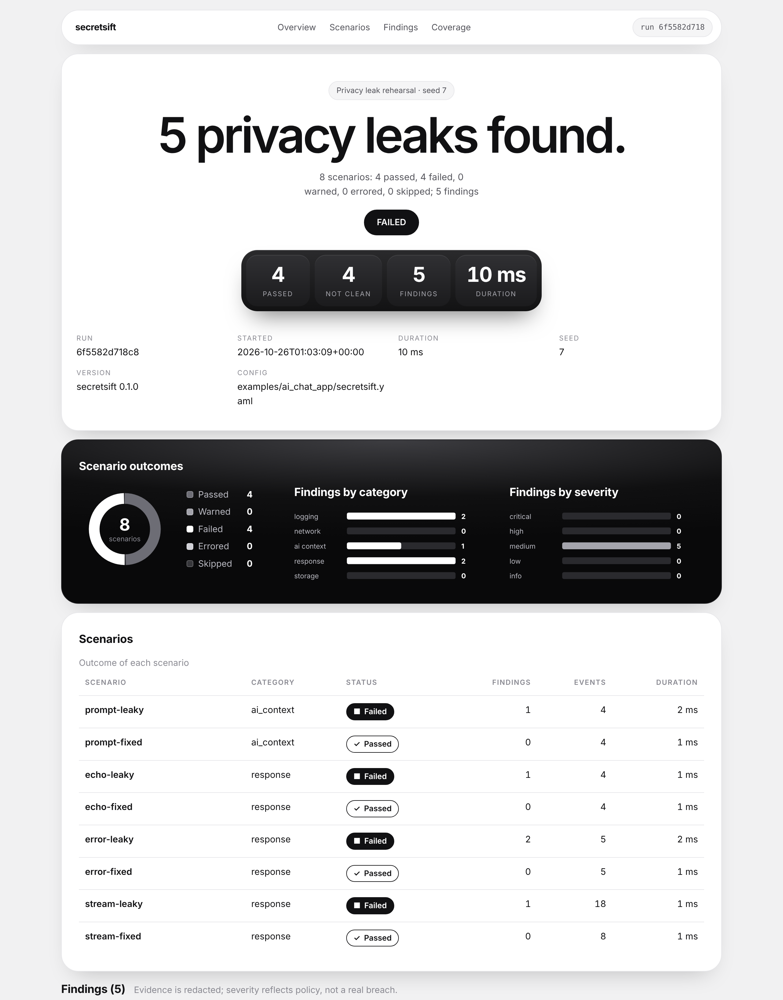
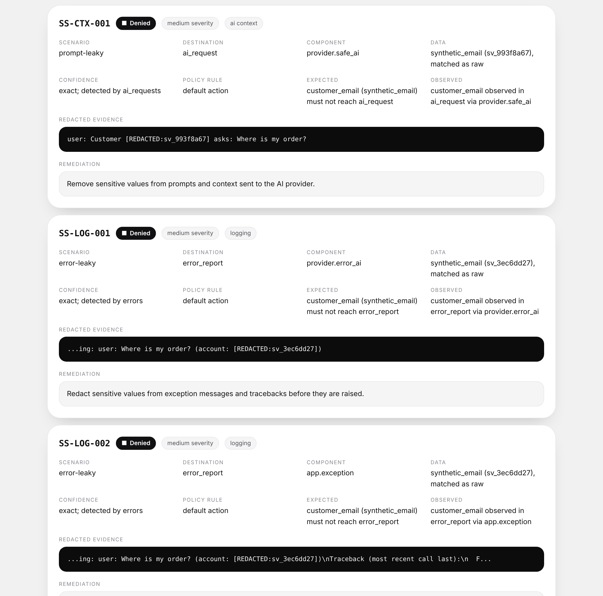
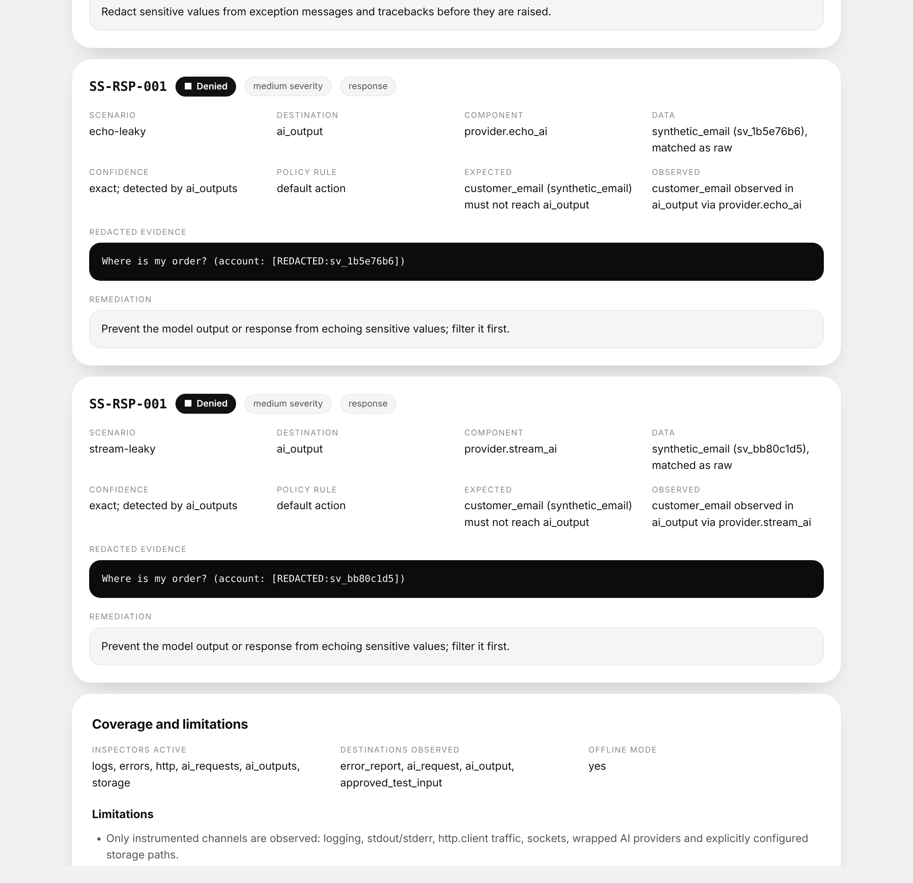

# secretsift

Local-first privacy leak rehearsal for AI-powered applications.

secretsift plants **fake ("synthetic") secrets** into your app, runs your code, and watches every
place the secret could surface: logs, stdout, error messages, outgoing HTTP, AI prompts, AI answers
(including streamed chunks) and files you point it at. Each sighting is checked against **your
policy**, and you get a report with redacted evidence. It runs on your machine or in CI. No server,
no account, no frontend.

**Not a secret scanner.** It does not search your code for real passwords. It plants *fake*
secrets, runs your code, and shows where they end up.

The command is `secretsift`; `sift` works as a short alias.

> Status: **alpha (0.1.0)**. See [Status and honesty notes](#status-and-honesty-notes).

## 60-second quickstart

Requires Python 3.11+. Runtime dependencies: `pydantic`, `pyyaml` only.

```bash
# from a checkout of this repository
python -m pip install -e .          # or: PYTHONPATH=src python3 -m secretsift ...

secretsift init                      # writes secretsift.yaml (refuses to overwrite)
secretsift validate                  # checks config + policy
secretsift test --report terminal,json,html,junit
```

Open `secretsift-reports/secretsift-report.html` in a browser. Reports are written with mode `0600`.

Want a zero-setup look first? `secretsift demo` runs the shipped example and writes the reports.

Real output of the starter config (one intentionally leaky function, one fixed function):

```text
Result:   FAILED
          2 scenarios: 1 passed, 1 failed, 0 warned, 0 errored, 0 skipped; 1 findings

  FAIL  leaky-login  (logging, 1 findings, 3 events, 2 ms)
  PASS  safe-login   (logging, 0 findings, 3 events, 1 ms)

  SS-LOG-001  HIGH  DENY  logging
    expected: customer_api_key (synthetic_api_key) must not reach application_logs
    where:    application_logs / secretsift.demo @ demo.py:24
    data:     synthetic_api_key (sv_99a8000b), matched as raw, exact
    evidence: login attempt api_key=[REDACTED:sv_99a8000b] note=hello
    fix:      Mask the key before logging, or do not log the request.
```

## What the report looks like

The HTML report is one self-contained file (no scripts, no external resources). Below is a real
report from [examples/ai_chat_app](examples/ai_chat_app/README.md) (8 scenarios, 5 intentional
leaks, mock AI). Open [docs/sample/ai-chat-report.html](docs/sample/ai-chat-report.html) in a
browser to see it live; the JSON twin is [docs/sample/ai-chat-report.json](docs/sample/ai-chat-report.json).
On a phone the table turns into stacked cards.

**Part 1: summary, charts and scenario table**



**Part 2: findings with redacted evidence and fix hints**



**Part 3: remaining findings, coverage and limitations**



Whole page in one image: [docs/images/report-preview-full.png](docs/images/report-preview-full.png).

## Commands

| Command | What it does |
| --- | --- |
| `secretsift init [path] [--force]` | write a starter config |
| `secretsift validate [--config FILE]` | validate config and policy (exit 3 on error) |
| `secretsift test` | run all scenarios (see flags below) |
| `secretsift report FILE.json --format terminal\|html\|junit\|json [--output PATH]` | convert an existing JSON report |
| `secretsift diff OLD.json NEW.json` | new / fixed / unchanged findings |
| `secretsift providers` | list AI providers and whether they are configured (never prints keys) |
| `secretsift doctor` | check Python, config, report dir, optional deps, provider env vars |
| `secretsift demo` | run the built-in demo and write reports |
| `secretsift version` | print the version |

`secretsift test` flags: `--config/-c FILE`, `--offline | --online`, `--filter CATEGORY`,
`--report terminal,json,html,junit`, `--output-dir DIR`, `--fail-on deny|warn|never`,
`--baseline PREVIOUS.json`, `--seed N`, `--no-color`.

Exit codes: **0** clean, **1** findings, **2** scenario errors only, **3** bad config or usage.

## Test your own app in 5 steps

No AI needed for this. Example: a signup function that accidentally logs the user's email.

**1. Your code** (`myapp.py`, in the folder you run commands from):

```python
import logging

log = logging.getLogger("myapp")


def signup(email, password):
    log.info("new signup for %s", email)  # BUG: puts the email into the logs
    return "ok"
```

**2. A config file** (`secretsift.yaml`; `secretsift init` writes a bigger annotated one you can edit):

```yaml
version: 1
sys_path: ["."]                 # where to import your code from (the folder you run in)
synthetic:
  values:                       # fake secrets secretsift will plant for you
    - {label: user_email, type: synthetic_email}
    - {label: user_password, type: synthetic_password}
policy:
  default_action: deny          # a fake value showing up anywhere unapproved is a violation
scenarios:
  - name: signup-does-not-leak
    category: logging
    target: "myapp:signup"      # module:function, called like signup(email=..., password=...)
    inputs: {email: "{{ user_email }}", password: "{{ user_password }}"}
    data: [user_email, user_password]
```

**3. Check it, then run it:**

```bash
secretsift validate
secretsift test
```

**4. Read the result.** secretsift generated a fake email and password, called
`myapp.signup(email=..., password=...)`, saw the fake email in the application logs, and, because the
policy says that is not allowed, reports a failure (exit code 1) with redacted evidence and a fix hint:

```text
  FAIL  signup-does-not-leak  (logging, 1 findings, ...)
  SS-LOG-001  ... DENY  logging
    expected: user_email (synthetic_email) must not reach application_logs
    where:    application_logs / myapp @ myapp.py:7
    evidence: new signup for [REDACTED:sv_xxxxxxxx]
    fix:      Do not log sensitive values; mask or drop the field before it reaches the logger.
```

**5. Fix your code** where the finding points (in `myapp.py`, log `"new signup"` without the email),
run `secretsift test` again, and it passes (exit code 0). Keep the config in your repo and run it in
CI so the leak cannot come back.

### Ways to plug it in

| You want to... | Use |
| --- | --- |
| try it on one function, or run in CI | the YAML + `secretsift test` (above); exit codes: 0 clean, 1 findings, 2 scenario errors, 3 bad config |
| check a leak inside your existing unit tests | the `Drill` SDK (see below), works with unittest or any framework |
| make every test auto-fail on leaks | the `secretsift` pytest fixture (see below) |
| test an AI feature | add `provider:` to a scenario (see "AI providers"); start with `mock` (fake, free), then a real model |
| block leaks in a pull request | [examples/ci_pipeline](examples/ci_pipeline/README.md) |

Nothing in secretsift is pre-filled: every number, finding and evidence line in a report comes from
the run you just did. The only fake things in the repository are labeled on purpose: the demo
functions in `secretsift.demo` and the `examples/` (intentionally leaky), and the `mock` AI provider.

## How you describe a test

```yaml
version: 1
seed: 1337
offline: true                      # blocks non-loopback network
synthetic:
  values:
    - {label: customer_api_key, type: synthetic_api_key}
policy:
  default_action: deny             # anything not explicitly allowed is a violation
  rules:
    - {id: R1, data: customer_api_key, destination: application_logs, action: deny, severity: high}
scenarios:
  - name: leaky-login
    category: logging
    target: "secretsift.demo:leaky_login"     # module:function, called with the inputs
    inputs: {api_key: "{{ customer_api_key }}", note: hello}
```

Run `secretsift init` to get a complete, validated starter file. Policy precedence: scenario-scoped
beats global, label beats data type beats `*`, exact destination beats `*`. Detection is not
violation: a value being *seen* only matters if policy says it must not be there.

Destinations: `application_logs`, `http_request`, `error_report`, `ai_request`, `ai_output`, `storage`.

## Use it inside your own tests

```python
from secretsift import Drill

with Drill(seed=1) as drill:
    email = drill.secret("user_email", "synthetic_email")
    my_app.signup(email)  # your code
drill.assert_clean()  # AssertionError with redacted findings if anything leaked
```

Works with any test framework. With pytest installed, the plugin provides a `secretsift` fixture
that fails the test at teardown on findings (opt out with `@pytest.mark.secretsift_allow_findings`).
The plugin registers itself when the package is installed; do not also list it in `pytest_plugins`
or pass `-p`, because pytest refuses to register the same plugin twice.
Runnable versions live in [examples/](examples/README.md).

## AI providers: mock (fake) vs real

`mock` (offline, deterministic), `ollama`, `llama_cpp`, `openai_compatible`, `openai`, `anthropic`,
`gemini`.

**The examples and the test suite use the `mock` provider.** It is a fake model that never touches
a network, so runs are free, repeatable and safe in CI. It can be told to misbehave on purpose
(echo the prompt, leak inside an error message, split a secret across stream chunks) so the
detectors have something to catch.

**With a real model the results are real.** secretsift wraps whatever provider you configure. Your
real prompt, the real answer, every streamed chunk and every provider error go through the same
inspectors and the same policy as with the mock. If a real model repeats your synthetic secret in
its answer, you get a real finding. Nothing else changes: same YAML, same reports.

How to switch (a local model, nothing leaves your machine; the file is
[examples/local_model/secretsift.yaml](examples/local_model/secretsift.yaml)):

```yaml
version: 1
offline: true                  # loopback (127.0.0.1) stays reachable
synthetic:
  values:
    - {label: customer_email, type: synthetic_email}
policy:
  default_action: deny
providers:
  ollama_local:
    type: ollama
    base_url: http://127.0.0.1:11434
    model: YOUR_PULLED_MODEL   # a model you pulled with `ollama pull`
scenarios:
  - name: my-chat-flow
    category: ai_context
    target: "my_app.chat:handle_message"   # your function; it receives `provider` as a keyword
    inputs: {user_email: "{{ customer_email }}", question: "Where is my order?"}
    data: [customer_email]
    provider: ollama_local
```

Your function calls `provider.complete(...)` or `provider.stream(...)` exactly like
[examples/ai_chat_app/chat_app.py](examples/ai_chat_app/chat_app.py). Hosted providers
(`openai`, `anthropic`, `gemini`) work the same way; see
[examples/hosted_api](examples/hosted_api/README.md).

Things to know with real models:

* Credentials come from environment variables (`OPENAI_API_KEY`, `ANTHROPIC_API_KEY`,
  `GEMINI_API_KEY`), are only sent as headers, and are never printed or stored in reports.
* Hosted providers need `offline: false` plus a `network_allowlist`. Your **synthetic** test data is
  then sent to that provider, and calls may cost money. Real customer data should never be used.
* Real models are not deterministic. A model may repeat the secret in one run and not in the next,
  so run important scenarios several times (`--seed`) before trusting a clean result.
* The real-provider code has **not** been run against live services yet (see below). Start with
  a local model and `secretsift test --config ...`; if a provider misbehaves, open an issue.

## Is there AI inside secretsift?

No. Detection is deterministic: exact match plus encoded variants (case-folded, URL-encoded,
base64, hex, JSON-escaped, whitespace-stripped). AI applications are what gets **tested**; providers
are just adapters. Everything works with no AI at all. Fixes are made by you, in your code, at the
component and location named in the finding; secretsift only prints a static hint per destination.

## Reports

| Format | Use |
| --- | --- |
| terminal | quick look, honors `NO_COLOR` |
| html | one self-contained file: no scripts, no external resources, redacted evidence |
| json | stable machine format (`secretsift-report/1`) for CI and `diff` |
| junit | CI test dashboards |

Evidence is redacted by default (`[REDACTED:<id>]`); raw synthetic values never reach reports.

## Project layout

More docs: [docs/quickstart.md](docs/quickstart.md), [docs/installation.md](docs/installation.md),
[docs/architecture.md](docs/architecture.md), [examples/](examples/README.md).

See [STRUCTURE.txt](STRUCTURE.txt) for the full tree with one line per file and who does what.
The binding design contract is [docs/DESIGN.md](docs/DESIGN.md).

## Development

```bash
PYTHONPATH=src python3 -m unittest discover -s tests -t . -q     # no pytest needed
```

See [CONTRIBUTING.md](CONTRIBUTING.md) and [SECURITY.md](SECURITY.md). License: Apache-2.0
([LICENSE](LICENSE)).

## Status and honesty notes

What has been verified (395 automated tests, run on Python 3.13): config and policy handling,
secret generation and encoded-variant matching, redaction, the log / stdout / HTTP / socket guards
(against a real local HTTP server), the six inspectors, the runner, all four report formats, the
CLI, the SDK and every offline example. Code was also syntax-checked with the Python 3.11 and 3.12
parsers.

What has **not** been verified, so treat it as untested until you run it once:

* Live AI providers. OpenAI, Anthropic, Gemini, Ollama and llama.cpp adapters were written from
  public API docs and tested with fake transports only. Wire formats may need a fix.
* The optional `httpx` transport and the `pytest` plugin: they were developed in an environment
  without `httpx`/`pytest`, so their real-library tests are skipped there (3 skipped tests). The
  core CLI and SDK do not import them.
* Python 3.11 and 3.12 at runtime (only 3.13 could run the suite), Windows and macOS.
* `python -m pip install .` / wheel build, the GitHub Actions workflows, `ruff` and `mypy`.
* The package name `secretsift` on PyPI, and the repository URLs in `CHANGELOG.md` and
  `.github/ISSUE_TEMPLATE/config.yml` (placeholders).

First-run check on a new machine (Codespaces, laptop, CI): one command runs everything that could
not be run during development and prints a PASS / FAIL / SKIP table:

```bash
bash scripts/verify.sh                          # install, tests, pytest plugin, ruff, mypy, wheel build,
                                                # clean install, CLI, examples
ALL_PYTHONS=1 AUDIT=1 bash scripts/verify.sh    # also other Python versions and a dependency audit
```

If a line says FAIL, that is a real bug in an area that was untested: please report it with the
output of that block. ruff/mypy FAILs are style or typing findings, not runtime crashes.

Scope limits: secretsift only sees what it instruments: Python logging, stdout/stderr,
`http.client`-based HTTP (urllib, requests), AI provider calls it wraps, and files you list. Other
processes, subprocess output, kernel-level traffic and uninstrumented services are **not**
observed. A clean report means "nothing seen", not "no leak possible". No performance benchmarks are
claimed.
