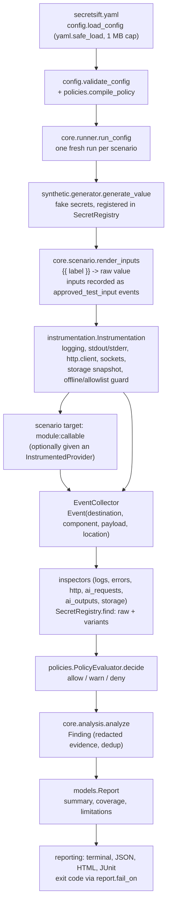

# Architecture

secretsift is a library plus an `argparse` CLI. There is no server and no frontend. One run is a
deterministic pipeline; detection is exact string matching (see [ai_and_automation](ai_and_automation.md)).

## Pipeline (what `secretsift test` actually does)

Step by step, per scenario (`core/runner.py::_run_scenario`):

1. A `RunContext` is created with a new random `run_id`, an empty `SecretRegistry` and an
   `EventCollector`.
2. For each label in the scenario's `data` (default: every declared label) a synthetic value is
   generated (deterministic when `seed` is set) and registered.
3. `inputs` are rendered (`{{ label }}` replaced by the raw value) and each rendered input is
   recorded as an `approved_test_input` event, which policy always allows.
4. The target (`package.module:callable`) is imported with `sys_path` prepended to `sys.path`
   (restored afterwards). If the scenario names a `provider`, it is built from the config
   `providers:` section and wrapped in `InstrumentedProvider`; it is passed as keyword
   `provider` only if the callable has a `provider` parameter or `**kwargs`.
5. Inside `Instrumentation` the callable runs. An exception is recorded as an `error_report`
   event; unless `expect_exception: true` it also marks the scenario errored.
6. Explicit `storage_paths` are scanned into `storage` events.
7. `analyze` runs each inspector over the events for its destination, asks the policy for each
   match, and turns deny/warn decisions into `Finding`s.
8. Status: any deny finding means FAILED; else any warn means WARNED; else an error means
   ERRORED; else PASSED. Findings take priority over errors.
9. The registry and collector are cleared in a `finally` block.

## Destinations, inspectors, finding IDs

| Destination | Produced by | Inspector | Finding category | ID prefix |
| --- | --- | --- | --- | --- |
| `application_logs` | `logging` handler, stdout/stderr tee | `logs` | logging | `SS-LOG` |
| `error_report` | exception raised by the target, provider errors | `errors` | logging | `SS-LOG` |
| `http_request` | `http.client` guard (URL, headers, body) | `http` | network | `SS-NET` |
| `ai_request` | `InstrumentedProvider` | `ai_requests` | ai_context | `SS-CTX` |
| `ai_output` | `InstrumentedProvider` (including aggregated stream) | `ai_outputs` | response | `SS-RSP` |
| `storage` | explicit `storage_paths` snapshot | `storage` | storage | `SS-STO` |
| `approved_test_input` | rendered scenario inputs | none (always allowed) | n/a | n/a |

IDs are sequential per prefix within a run (`SS-LOG-001`, `SS-LOG-002`, ...). Duplicates
(same scenario, value, destination, component, location) are merged into `occurrences`.

## Module responsibilities (`src/secretsift/`)

| Module | Responsibility |
| --- | --- |
| `cli.py`, `__main__.py` | argparse CLI: `init doctor providers validate test report diff demo version`; exit codes |
| `api.py` | `Drill` SDK context manager (no YAML) |
| `config.py` | pydantic config models, `load_config`, `validate_config`, starter YAML |
| `models.py` | shared types: `Destination`, `DataType`, `Action`, `Severity`, `Event`, `Match`, `Finding`, `Report`, ... |
| `contracts.py` | abstract `Inspector`, `Reporter`, protocols for registry, evaluator, sink |
| `exceptions.py` | `ConfigError`, `PolicyError`, `ProviderError`, `OfflineViolationError`, `SecurityError`, `ScenarioError` |
| `demo.py` | intentionally leaky and safe demo targets used by the starter config |
| `synthetic/` | value generation (`generator`), variant building (`normalize`), `SecretRegistry` find/redact |
| `evidence/redaction.py` | redacted evidence snippets, credential masking (`redact_credentials`) |
| `core/runner.py` | `run_config`, target import, status derivation, `LIMITATIONS` |
| `core/scenario.py` | `ScenarioSpec` model and `{{ label }}` templating |
| `core/context.py`, `core/lifecycle.py`, `core/events.py` | per-run state, guaranteed cleanup, thread-safe event collector |
| `core/analysis.py` | inspectors + policy -> findings, dedup, streaming aggregation |
| `instrumentation/` | `Instrumentation` (`capture.py`) plus `logcapture`, `stdio`, `httpguard`, `sockets`, `storage` |
| `inspectors/` | one `PayloadInspector` subclass per destination, `default_inspectors()` |
| `policies/` | `schema` (YAML models), `loader` (validation/compile), `evaluator` (decisions), `rules` (remediation hints) |
| `providers/` | `Provider` ABC, mock, six HTTP adapters, `transport`, `registry`, `InstrumentedProvider` |
| `integrations/` | optional `httpx_transport` and `pytest_plugin` (lazy optional imports) |
| `assertions/` | `assert_no_findings`, `compare_to_baseline`, `regression_findings` |
| `reporting/` | terminal, JSON, HTML, JUnit reporters, `diff`, `safe_io` (atomic, 0600 writes) |

## Extension points (as implemented)

* New provider adapter: subclass `Provider`. YAML `providers.<name>.type` accepts only the built-in
  types, so a custom adapter is used from Python; see [provider_guide](provider_guide.md).
* New inspector: subclass `Inspector` and pass it to `core.analysis.analyze`. The CLI runner uses
  `default_inspectors()` and has no plugin hook.
* Policy: YAML only; see [policy_reference](policy_reference.md).
* Scenario: any Python callable referenced as `module:callable`.

## Concurrency and global state

Instrumentation patches `logging`, `sys.stdout/stderr`, `http.client`, `socket.socket.connect`,
`connect_ex` and `socket.getaddrinfo` process-wide, reference counted, and restores them on exit.
Run scenarios sequentially in one process (the runner does).
